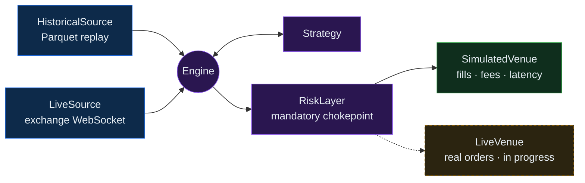

  

  
  
  
  

CS @ Scaler School of Technology ('28)

I like building systems where correctness is checked, not assumed: a trading engine where backtest, paper and live run the same code path, a document pipeline that survives worker restarts, and infrastructure that can be destroyed and rebuilt from Terraform.

## 📈 Flagship: [quant](https://github.com/alienxviking/quant)

A quantitative trading platform in Rust. It captures market data, replays it deterministically, and runs **one strategy binary across backtest, paper and live trading with no code changes**.

| Mode | Source | Venue |
|---|---|---|
| Backtest | Historical | Simulated |
| Paper | Live | Simulated |
| Live | Live | Live |

- 🧱 **12 crates, 30K lines, 416 tests:** recorder, order-book reconstruction, Parquet normalization, engine, simulated venue and an offline verifier
- 🎯 **A 14-day live paper run reproduced its backtest exactly**: same fills, cash and realized P&L to the satoshi, across 97.9M recorded frames with zero missing
- 💰 **Money is fixed-point `i64`**; float arithmetic is denied by clippy across the whole workspace
- 🛡️ **Risk is a mandatory chokepoint**, not a library the strategy chooses to call: an oversized order never reaches the venue

## 🛠️ Other work

<table>
  <tr>
    <td width="50%" valign="top">
      <h3>🖍️ <a href="https://github.com/alienxviking/redpen">RedPen</a></h3>
      AI marking for answer papers. Every mark is tied to a verbatim quote from the student, mapped quote → character span → page rectangle, so the mistake is boxed where it actually is. The model judges, but code does the arithmetic: marks are clamped to the rubric and totals reconciled. Four model backends behind one interface; 102 offline tests.
        
      <code>TypeScript</code> <code>React</code> <code>pdf.js</code> <code>Claude / Gemini / Groq</code>
    </td>
    <td width="50%" valign="top">
      <h3>🔎 <a href="https://github.com/alienxviking/sift">sift</a></h3>
      Document processing and hybrid search. Uploads (PDF, images, DOCX) go to Celery workers for text extraction, OCR, thumbnails and local embeddings, then become searchable through Postgres full-text + pgvector fused with Reciprocal Rank Fusion. Multi-tenant, with live status over WebSockets.
        
      <code>FastAPI</code> <code>Next.js</code> <code>Celery</code> <code>pgvector</code>
        
      
    </td>
  </tr>
  <tr>
    <td width="50%" valign="top">
      <h3>🏎️ <a href="https://github.com/alienxviking/scaler-HFT-C--2028/tree/capstone-order-book-10155/Capstone/24bcs10155-Snehangshu-Roy_24bcs10246-Saniya-Patil">Limit order book (C++)</a></h3>
      Three book designs benchmarked on 1M-op workloads. Ours (flat price array + bitmap + open-addressing table) won every op: <b>56.7 ns</b> add, <b>38.3 ns</b> cancel, <b>3.8×</b> faster than the <code>std::map</code> book. Explained with <code>perf</code> counters: ~5× fewer L1 misses, IPC 1.41 vs 0.79. Team of 2.
        
      <code>C++17</code> <code>perf</code> <code>Docker</code>
    </td>
    <td width="50%" valign="top">
      <h3>🤖 <a href="https://github.com/alienxviking/web-automation-agent">web-automation-agent</a></h3>
      A browser agent that works from screenshots instead of CSS selectors. A vision LLM looks at the page, decides where to click and type, and drives Chromium through Playwright. Comes with a web UI to watch it work live, and a CLI.
        
      <code>Python</code> <code>Playwright</code> <code>Llama 4 vision (Groq)</code>
    </td>
  </tr>
  <tr>
    <td width="50%" valign="top">
      <h3>💬 <a href="https://github.com/alienxviking/nexo">nexo</a></h3>
      Real-time 1:1 chat with sent/delivered/seen receipts, typing indicators, voice notes, and scheduled and self-destructing messages. Message delivery goes through Redis pub/sub so the socket servers can scale out.
        
      <code>Socket.io</code> <code>Redis</code> <code>Prisma</code> <code>Postgres</code>
        
      
    </td>
    <td width="50%" valign="top">
      <h3>☁️ <a href="https://github.com/alienxviking/devops-homework">DevOps on real AWS</a></h3>
      21 hands-on labs ending in TripBoard: GitHub Actions with SAST, dependency and secret scanning plus a Trivy gate, images to GHCR, Helm on Kubernetes, Argo CD GitOps, Prometheus + Grafana. Terraform provisions kind locally or EKS on AWS.
        
      <code>Terraform</code> <code>EKS</code> <code>Helm</code> <code>Argo CD</code>
    </td>
  </tr>
  <tr>
    <td width="50%" valign="top">
      <h3>🔥 <a href="https://github.com/alienxviking/momentum">momentum</a></h3>
      A social accountability app: habit streaks, group leaderboards driven by a computed 0–100 accountability score, peer reviews, challenges and weekly recaps. Installable PWA with web push.
        
      <code>Next.js</code> <code>Supabase</code> <code>PWA</code>
        
      
    </td>
    <td width="50%" valign="top">
      <h3>⚡ Right now</h3>
      Taking <a href="https://github.com/alienxviking/quant">quant</a> from paper trading to live order routing: the engine gains a second asynchronous input, and every live fill gets reconciled against the exchange.
    </td>
  </tr>
</table>

## 🧰 Stack

  

## 🤝 Work with me

I take contract work in **backend and systems engineering**, **AI agents and RAG pipelines**, and **cloud infrastructure (AWS, Kubernetes, Terraform)**.

  

