  
  
  
  

## Flagship: [quant](https://github.com/alienxviking/quant)

A quantitative trading platform in Rust. One strategy binary runs **backtest, paper and live trading with no code changes**. Only the data source and the venue are swapped, so a backtest can't describe a system that was never run. Money is fixed-point `i64` with float arithmetic denied workspace-wide. The engine dispatches on receive time only, so lookahead bias has no way in. Every order passes a risk layer that the strategy can't bypass.

**Now:** M8, taking it live with tiny capital. The bar: our record and the exchange's agree exactly, for every order.

## Selected work

  
  

  
  

  
  

  Live demos: <a href="https://sift-docprocess.vercel.app/">sift</a> · <a href="https://nexo-navy.vercel.app">nexo</a> · <a href="https://momentum-seven-flame.vercel.app">momentum</a> (habit-accountability PWA) &nbsp;|&nbsp;
  Low-level design in Java: <a href="https://github.com/alienxviking/rate-limiter">rate-limiter</a> · <a href="https://github.com/alienxviking/distributed-cache">distributed-cache</a> · <a href="https://github.com/alienxviking/parking-lot">parking-lot</a>

## Stack

  

